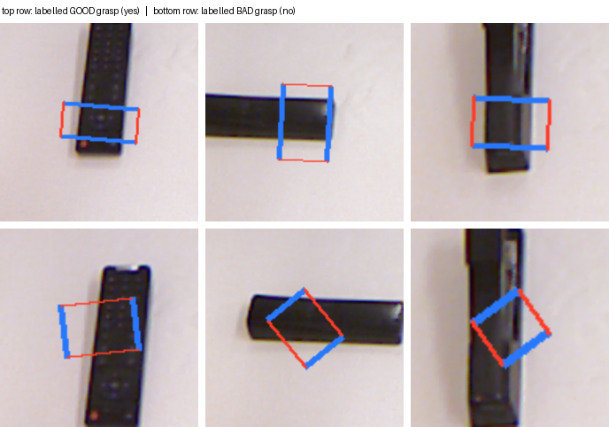

# Grasp-success judging with a fine-tuned VLM

Fine-tunes **Qwen2.5-VL-3B-Instruct** with 4-bit QLoRA to answer one question
about a robot grasp: *would this grasp pick the object up?*

Labels come from the [Cornell Grasp Dataset](https://www.kaggle.com/datasets/oneoneliu/cornell-grasp),
which annotates each tabletop photo with positive (`cpos`) and negative
(`cneg`) parallel-jaw grasp rectangles.

## Result

| | Accuracy | Good grasps found | Bad grasps caught |
|---|---|---|---|
| Base model | 50.8% | 60/60 | 1/60 |
| Rectangle width alone | 70.8% | — | — |
| After QLoRA, RGB | 89.2% | 55/60 | 52/60 |
| After QLoRA, RGB + depth (one strip) | 78.3% | 48/60 | 46/60 |
| After QLoRA, RGB + depth (**two images**) | **90.0%** | 55/60 | 53/60 |

120 held-out examples, balanced, identical rectangles across every row.
Training took 10-12 minutes on an RTX 5090.

The base model scores near chance for a specific reason worth calling out: it
answers "yes" to almost every grasp, good or bad. It isn't judging the image,
it's agreeing with the question. Fine-tuning is what turns it into an actual
discriminator, and the per-class numbers are reported precisely so that
distinction is visible rather than hidden inside one accuracy figure.

**The second row needs explaining.** Cornell's positive rectangles are
systematically narrower than its negatives — median gripper gap 27px against
38px across all 8,020 annotated rectangles. A one-line rule, "call it good
when the gap is under 31px," fits on train and scores 70.8% on the held-out
set without ever looking at the object. So plain accuracy on this dataset is
not, on its own, evidence of grasp understanding.

## Is the model just measuring rectangle width?

No. That was the obvious worry, so it got its own measurement rather than an
argument. `eval_width_matched.py` pairs every negative with a positive of
near-identical gripper gap, which flattens the cue: the two classes end up
with the same median gap (24.0px) and the same IQR, and the best possible
width threshold — tuned on the matched set itself, the most generous reading
available — falls to **51.2%**, chance.

Scored on those 240 matched examples:

| | Accuracy | Good found | Bad caught |
|---|---|---|---|
| Width threshold | 51.2% | — | — |
| QLoRA, RGB | **85.4%** | 111/120 | 94/120 |
| QLoRA, RGB + depth (one strip) | 72.1% | 92/120 | 81/120 |
| QLoRA, RGB + depth (two images) | 82.5% | 100/120 | 98/120 |

The RGB model gives up only a few points when the shortcut is destroyed, and
stays 34 points above chance. Whatever it learned survives the removal of the
cue that could have faked it. `width_shortcut_baseline()` also recomputes the
train-fitted version on every training run, so the number is never quietly
lost.

## Does depth help?

An RGB photo cannot distinguish a tall upright box from a flat one, which is
most of what decides whether a grasp holds. The dataset ships point clouds, so
`prepare_depth.py` fits the tabletop plane in each `pcd####.txt` and caches a
per-pixel height-above-table map. Depth is **not** a 3D tensor: Qwen2.5-VL
only takes images, so height is a second picture (black = table, brighter =
taller, 0-15 cm).

How that second visual is given to the VLM matters more than whether depth is
present:

| | Original 120 | Width-matched 240 |
|---|---|---|
| RGB only | 89.2% | **85.4%** |
| RGB + depth, glued into one wide strip | 78.3% | 72.1% |
| RGB + depth as **two images** | **90.0%** | 82.5% |

Gluing RGB|height into one image was the thing that hurt. Native multi-image
(first image = RGB grasp, second = height) recovers almost all of the RGB
accuracy and slightly beats it on the original split (108/120 vs 107/120).
On the harder width-matched set RGB is still a few points ahead, so depth is
not a clear win — but it is no longer a loss.

`DEPTH_LAYOUT = "two_images"` is the default. `"concat"` reproduces the
strip ablation. `USE_DEPTH = False` is RGB-only. Each run writes a separate
results file.

## How the grasp is shown to the model

Each candidate grasp is drawn onto the scene and shown with surrounding
context — blue lines are the two gripper plates, red lines are the direction
they close in.



The signal is geometric: a good grasp closes across the object's narrow axis,
while a bad one closes along its length or at a skewed angle. Both need the
object *and* the gripper orientation to be visible in the same picture.

The flat view is easy to misread, though. On `pcd0530` the dark shape is a
box standing upright, and most of what you see is its *side wall*, not its
top — the camera looks down at a slight angle. Reading finger heights off the
point cloud (`check_3d.py`) makes the actual geometry explicit:

| rectangle | finger 1 | finger 2 | gripper gap |
|---|---|---|---|
| good #0 | 110 mm | 2 mm | 39 px |
| good #3 | 110 mm | 110 mm | 27 px |
| bad #0 | 2 mm | 2 mm | 89 px |

Good #3 puts both fingers on the top rim of the box: a clean pinch. The bad
rectangle puts both fingers on the tabletop with the jaws far wider than the
box, closing on nothing. `inspect_scene.py` renders every rectangle on a
scene, and `explain_grasp.py` draws the closing motion.

An earlier version of this experiment cropped the grasp rectangle out of the
image instead of drawing it on. That crop destroyed exactly the information
the label depends on, and the run stayed at chance (51.7% → 48.3%, kept in
`results/tight_crop_ablation.json`). Switching to the overlay representation
is what made the task learnable — a bigger factor than any hyperparameter.

## Setup

```bash
pip install -r requirements.txt
python prepare_cornell.py      # downloads the dataset into ./data/cornell
python prepare_depth.py        # caches height maps into ./data/heightmaps
python finetune_grasp_vlm.py   # trains and writes results/
```

The original Cornell host (`pr.cs.cornell.edu`) no longer resolves, so
`prepare_cornell.py` pulls the Kaggle mirror, which preserves the original
file layout.

## Method

- **Model**: Qwen2.5-VL-3B-Instruct, 4-bit NF4 quantization
- **Adapter**: LoRA `r=16`, `alpha=32`, applied to attention *and* MLP
  projections (`q/k/v/o/gate/up/down`), 37M trainable parameters (1.0%)
- **Data**: 600 train / 120 eval views, balanced yes/no, **split by source
  image** so no tabletop photo appears in both halves
- **Schedule**: 3 epochs, lr 1e-4 cosine, effective batch size 4
- **Metric**: the `yes` and `no` token logits are compared directly instead of
  parsing generated text, so the score measures the decision and not the
  phrasing

## Limitations

**No grasp here was ever executed.** Cornell's rectangles were drawn by human
annotators as "this looks graspable." There is no mass, no friction and no
gripper force anywhere in the dataset, so nothing in it — and nothing in this
model — can tell you whether a given grasp would actually slip. "Good" means
"an annotator approved this rectangle," and the model is trained to reproduce
that judgement, not physics.

The width-matched result says the model reads the picture rather than a
labelling artifact — but "reads the picture" still means predicting the
annotator, since that is all the labels contain.

Cornell is also small and shot on a single tabletop setup, so this measures
grasp geometry recognition, not generalization to a new cell. Validating
against grasps a robot actually attempted is the step that would make the
metric mean what it appears to mean.
